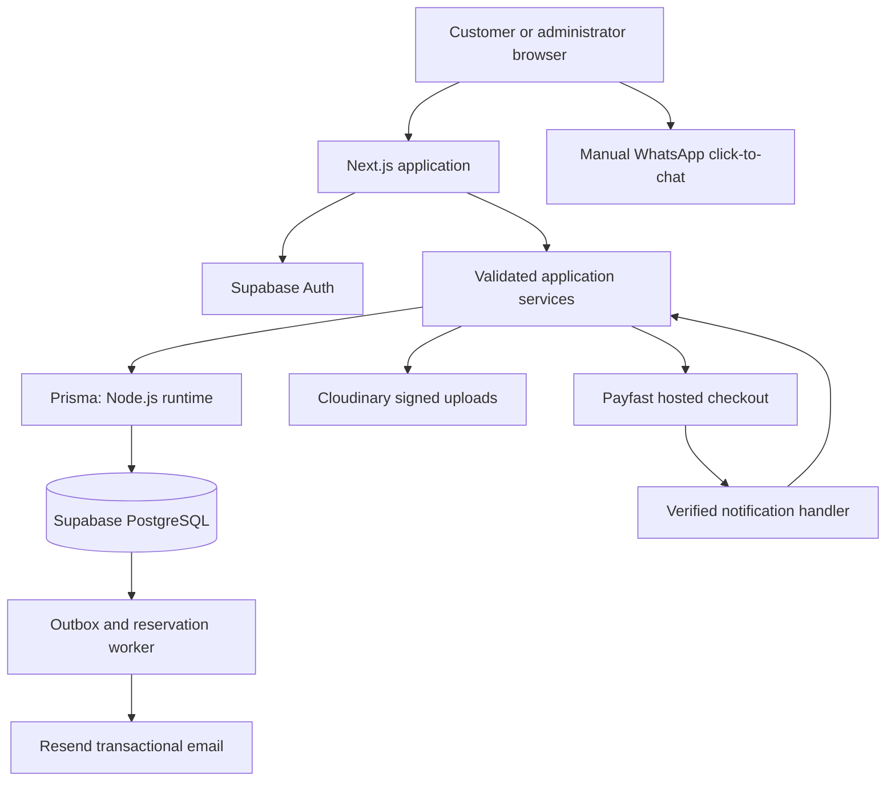

# Architecture

Status: proposed production architecture; Phase 1 foundation implemented after owner approval on 14 October 2026 (Africa/Johannesburg).

## Business invariants

S & D Fruit and Veg trades at 155 Gemsbok Street, Lenasia, 1827, Johannesburg, South Africa; phone 083 504 3385 / +27835043385. Tagline: “Freshness You Can Trust. Quality You Can Taste.” Hours: Monday–Saturday 08:45–18:00 and Sunday 09:00–16:00. Language English; currency ZAR; business timezone Africa/Johannesburg.

The business is not VAT-registered. There is no separate VAT charge, invented VAT number, “VAT included” claim or VAT tax invoice. Delivery is free within the approved Lenasia area and has no minimum order. Collection is supported. Customer-selected time slots are excluded. Orders require verified authentication; browsing and carts support guests.

The nominal 19:00 ordering cutoff is independent of opening hours, same-day eligibility and expected fulfilment. Same-day promises remain disabled until the owner approves the operational rule. The administrator will control calendars, availability, capacity, deadlines and closures. Receipts must never be interpreted as promises of same-day fulfilment.

## System shape

One Next.js App Router application provides public pages, customer accounts, administration and integration endpoints. Server Components render reads; Server Actions validate mutations and call application services. Route Handlers receive external notifications, provide authorized exports and sign image uploads. Business services own transactions and status transitions; components never perform financial decisions.

Prefer standard framework and PostgreSQL capabilities. No microservices, Redis, separate search platform or paid WhatsApp API is required initially. Add libraries only when their phase needs them: Prisma in Phase 3, Supabase Auth in Phase 4, Payfast in Phase 6, reports/email in Phase 8. React Hook Form supports complex forms; Motion supports selected interactions in the design phase.

## Identity, authorization and RLS

Supabase Auth owns passwords, verification, Google OAuth and recovery. The application stores a profile linked to an auth UUID, never a copy of passwords. Verify identity on every protected server entry point; do not trust unverified session cookies. Administrator role checks occur on the server for every operation, not just navigation or layout guards. Role assignment is not a customer-editable profile field. Provision the sole production administrator through a controlled process with MFA and recovery instructions in Phase 4/7.

Commerce tables will use a private schema excluded from Supabase's public Data API. Revoke browser roles' table/schema privileges. RLS denies browser roles access; a dedicated server role receives only explicitly necessary table privileges and RLS policies. The runtime role is not a schema owner, superuser or migration role and cannot change roles or schema.

Prisma does not automatically propagate the logged-in user's identity into PostgreSQL policies. RLS therefore does not replace application authorization: the server data-access layer must scope customer reads and writes to the verified profile ID. Prove this with two-customer access tests and direct Data API denial tests. Never use a client-provided customer ID as authority.

Use separate migration credentials. Avoid Supabase service-role secrets in the public app; administrator identity provisioning, when implemented, uses an explicitly privileged operator workflow. No personalized response, session refresh or customer record enters a shared cache.

## Database and hosting compatibility

Prisma runs under Node.js, not the Edge runtime. Application traffic uses Supabase's transaction pooler; migrations use a direct or session-pooler connection (for IPv4 compatibility where needed). Pin Prisma/adapter versions in Phase 3. Confirm driver-specific prepared-statement behaviour, SSL validation, transaction semantics and a small connection pool. Do not assume legacy connection query parameters configure the modern pg adapter.

Netlify's Next.js adapter documents App Router, SSR, Server Components, Server Actions, Route Handlers and caching support. Use Netlify's managed adapter and record its version in deployment evidence. Keep vendor-specific schedules thin and business jobs portable. Avoid provider-dependent application storage.

Netlify Free permits commercial projects, but the current credit plan can suspend projects at its limit. Supabase Free can pause low-activity databases. Free service quotas and domain/payment costs must be tracked; no uptime guarantee is assumed. An actual hosted compatibility test requires the later deployment approval.

References checked during planning:

- [Next.js on Netlify](https://docs.netlify.com/build/frameworks/framework-setup-guides/nextjs/overview/)
- [Netlify Free commercial use](https://www.netlify.com/blog/introducing-netlify-free-plan/)
- [Netlify current pricing](https://www.netlify.com/pricing/)
- [Supabase Prisma integration](https://supabase.com/docs/guides/database/prisma)
- [Supabase SSR authentication](https://supabase.com/docs/guides/auth/server-side/creating-a-client?framework=nextjs&queryGroups=framework)
- [Supabase Free pausing](https://supabase.com/docs/guides/platform/free-project-pausing)

## Order transaction

1. Verify identity and policy acceptance; validate the request and checkout idempotency key.
2. Reload active variants, authoritative decimal prices and current promotions.
3. Validate a structured delivery address against the approved area and current rules, or select collection.
4. Lock affected inventory in stable variant-ID order. Atomically check available units and promotion limits.
5. Create the order and immutable contact/address/item/discount/settings snapshots, reservations, payment attempt and promotion redemption holds.
6. Insert durable notification/outbox records and commit.
7. Invoke external services after commit. A service outage must not erase or invalidate an accepted order.

Use bounded retries for serialization conflicts and a unique customer/idempotency key with a request fingerprint. A duplicate request returns the existing order; different contents with the same key produce a conflict. No external network calls inside stock transactions.

Guest carts have unpredictable opaque tokens stored in secure cookies, hashed at rest. Cart merge locks both carts, combines identical variants with checked limits, reports adjustments and marks the guest cart consumed. Repeated login must not duplicate lines. Reordering loads current prices/availability rather than copying old totals.

## Inventory and payment races

Phase 6 implemented choice: late verified funds are recorded with an exception and the expired/cancelled order stays closed. Automatic stock reacquisition is deferred; refund/reconciliation is available through the MFA-gated payment administration. The payment setup guide describes current local behavior and hosted verification gates.

Variants represent fixed selling quantities; cart quantities are integer counts of a variant. Available stock is on-hand minus held allocations. Independent pack sizes require explicitly allocated stock; do not count the same loose produce in multiple variant balances.

Proposed Payfast hold: 20 minutes, configurable and validated during sandbox testing. Manual EFT receives an owner-approved deadline. COD and collection-payment allocations remain until fulfilment or cancellation. Reservation states are held, consumed and released. Payment verification and expiry lock the same records and use guarded transitions.

A verified late payment is still real money received. Atomically reacquire stock if possible; otherwise flag a paid exception for administrator resolution/refund. Never hide such a receipt by marking it unpaid or automatically fulfil unavailable stock. Successful second attempts create an overpayment exception, not duplicate fulfilment. Cancellation and refunds do not erase payment history.

Hosted Payfast requests use server-calculated amounts, unique references and correct canonical signatures. Verify ITN signature, trusted source, merchant/order references, currency/amount and provider server validation before applying transitions. Preserve the required field encoding. Proxy source-IP handling must be tested on the selected host. Browser return URLs never authorize payment success. Persist deduplicated payment events and reconciliation outcomes. No card data is stored.

Refund requests remain pending until external completion is verified or manually reconciled with audited evidence. Enforce cumulative refund limits transactionally. Perishable returns are not restocked automatically. Partial refunds reduce net receipts. Fulfilment, order lifecycle and payment state remain independent.

[Payfast official integration checks](https://payfast.io/integration/submit-your-solution/) and [developer documentation](https://developers.payfast.co.za/docs) are the implementation authorities; recheck them in Phase 6.

## Background jobs and communication

Phase 8 implements these boundaries through the additive communications migration and a dedicated restricted worker role. Database triggers enqueue snapshots and alerts atomically with order/payment changes; provider calls run only after commit. The bounded worker supports local capture, stable Resend idempotency keys, frozen requests, fenced leases, retry deadlines and separately verified delivery events. Scheduling is an operator endpoint/CLI interface; hosted scheduling is not configured. See [communications and reporting operations](communications-and-reports.md) for current state definitions and launch checks.

PostgreSQL outbox jobs have unique event keys, bounded payloads, attempts, leases and retry deadlines. A scheduled worker claims batches safely, retries with backoff, releases expired leases and exposes permanently failed jobs to the administrator. Email delivery events are separate from send attempts. Provider acceptance is not inbox delivery.

Inventory expiry uses a separate idempotent handler. Catch up after missed schedules; checkout rechecks current reservations. Monitor scheduler lag, payment exceptions and outbox backlog. Test Netlify scheduled functions before launch; functions are not an assumed durable queue.

Administrator alerts are database-backed. WhatsApp is manual: prepared, link-opened and administrator-marked-sent are distinct audit actions. No automatic message transmission or delivered claim. Only validated values from the selected order populate messages.

Authentication email delivery will require a production mail configuration in Phase 4; using Resend SMTP for Supabase Auth is a separate integration from Phase 8 order templates/outbox. Supabase default test email behaviour is not a production delivery solution.

## Security, privacy and recovery

Validate all input server-side; enforce origin/CSRF checks, request sizes, durable rate limits and least privilege. Configure an application-specific CSP after payment, image and auth flows exist; test before enforcing. Phase 1 supplies nosniff, frame denial, referrer/permissions policies and noindex. These headers are not a completed security review.

Cloudinary upload signatures require administrator authorization and bounded formats/sizes. Validate actual assets before attaching them. Replace the database reference only after a successful upload; retire old assets through retryable cleanup. Log asset licensing and alt text.

Privacy access/deletion must verify identity, honor approved financial retention, redact audit payloads and separate marketing consent from transactional communication. Legal policies remain owner-approved drafts until reviewed for POPIA, CPA and ECTA, including cross-border processors.

Backups must cover the application schema, required authentication recovery, grants/policies, settings and asset references; Cloudinary originals need a separate recovery plan. Store encrypted copies outside the database project and test restoration. Owner must approve retention and RPO/RTO. Free-plan provider backups are not assumed to satisfy recovery requirements.
